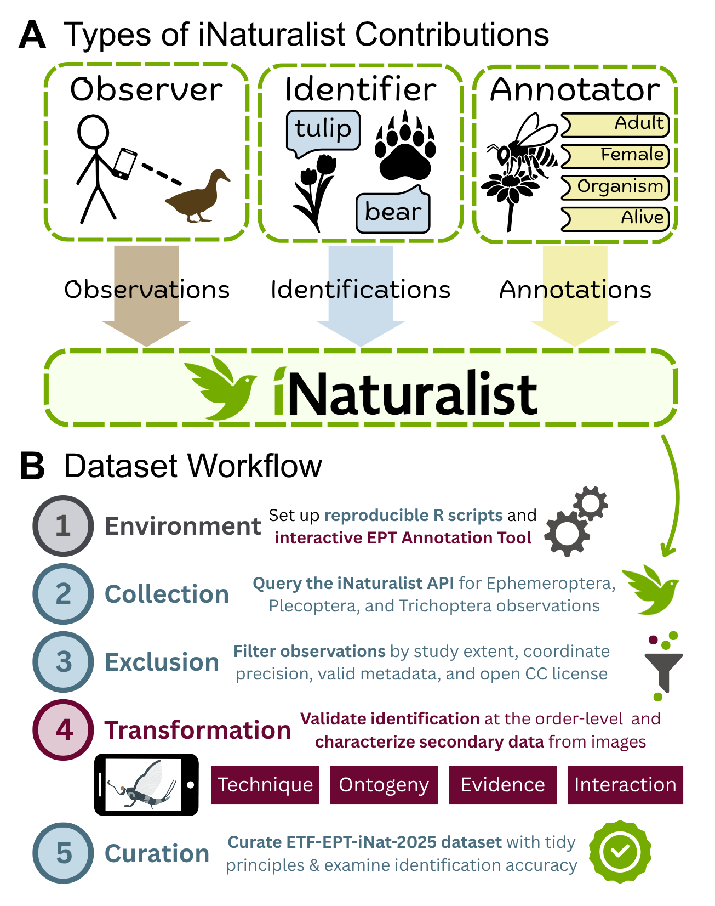
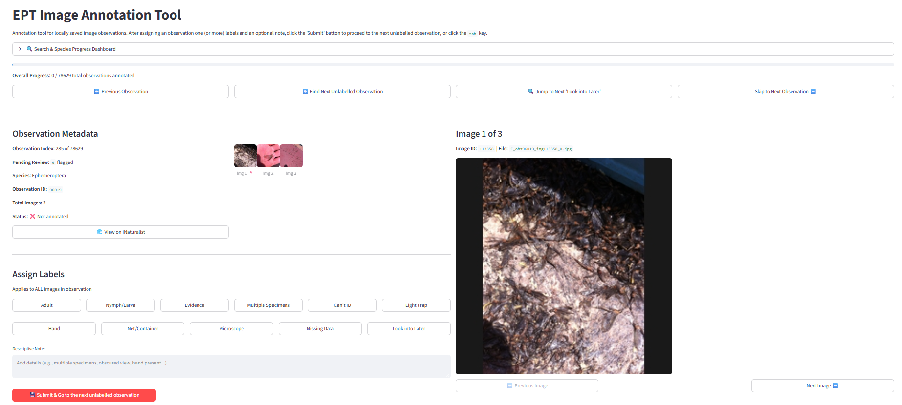

# ETF-EPT-iNat-2025 Dataset: Aquatic insect records transformed by secondary data from iNaturalist images

## Identifiers

Dataset title: ETF-EPT-iNat-2025

Data identifier DOI: *[complete upon acceptance]* **TO DO**

Data paper DOI: *[complete upon acceptance]* **TO DO**

License: [see LICENSE file](LICENSE)

Keywords: biology, citizen science, computer vision, ecology, machine learning, macroinvertebrates, morphology, ontogeny, phenotypic traits, sampling technique, spatial bias modelling, taxonomy

Data paper citation: *[complete upon acceptance]* **TO DO**

## Authors

[Karina M. Torres*](https://ktorres23.github.io) ([ORCID](orcid.org/0009-0003-0578-094X)), [Brent S. Pease](https://www.peaselab.com) ([ORCID](orcid.org/0000-0003-1528-6075))

*corresponding author email: torres06km@gmail.com

## Status

version: 1.0.0

latest update: 2026-10-06

latest archive date: **TO DO**

metadata status: 2026-10-06

data verification: Last QA/QC analysis 2026-10-06

# Research Origin Descriptors

## Study Design

Project title: ETF-EPT-iNat-2025 Dataset: Aquatic insect records transformed by secondary data from iNaturalist images

Objectives: Curate a human-verified, annotated dataset enriched by secondary image data called ETF-EPT-iNat-2025, containing aquatic insect iNaturalist observations across the Eastern Temperate Forests of North America from 2000 to 2025 for the orders of Ephemeroptera (mayflies), Plecoptera (stoneflies), and Trichoptera (caddisflies)

Funding: **TO DO**

## Subproject / Sampling Site Descriptors

### Site Description

The study area encompasses the Eastern Temperate Forests ecoregion, delineated using the hierarchical classification framework established by Omernik and Griffith (2014) and the U.S. Environmental Protection Agency (U.S. EPA Office of Research and Development, 2024). This framework geospatially delineates ecosystems based on biophysical conditions and natural resources. The Eastern Temperate Forests are classified as a Level 1 ecoregion covering half of the land area of the conterminous U.S. This region is characterized by a mildly humid climate, conifer and hardwood forests, and high human population (Commission for Environmental Cooperation (CEC), 1997). 

### Experimental / Sampling Design

Design characteristics: Opportunistic sampling by observers on iNaturalist. Quality control process described below to remove erraneous and nonreproducible observations.

Spatial extent: Level 1 Ecoregion of the Eastern Temperate Forests of North America

Temporal extent: 1 January 2000 to 31 December 2025

Spatial grain/resolution: Geographic coordinates with <100m spatial uncertainty

Temporal grain/resolution: Date an organism was observed (e.g., 2023-05-27)

### Research Methods

Data collection protocol:

[Figure Workflow](misc/workflow_figure.png). **(A)** Types of users and data contributions on iNaturalist, including observers, identifiers, and annotators who produce observations of organisms, classify organisms by taxonomic names as an identification, and add secondary data from the image of the organism as an annotation. **(B)** Dataset workflow process, spanning (1) software environment, (2) data collection, (3) data exclusion, (4) data transformation, and (5) dataset curation and validation.

All occurrence records, or observations, of Ephemeroptera, Plecoptera, and Trichoptera (EPT) were obtained from the iNaturalist API v1 (api.inaturalist.org/v1/docs) with the following R packages: httr (Wickham, 2023) and jsonlite (Ooms, 2014). The iNaturalist API v1 (api.inaturalist.org/v1/observations) was queried to retrieve observations of EPT (respective taxon IDs: 48011, 47504, 62164). Because the iNaturalist API has daily limits for retrieving data, observations were retrieved over multiple days in November 2025 and February 2026, with a final retrieval date of 10 February 2026.

After the raw observation data went through data entry verification procedures (described below), we downloaded all images associated with our filtered dataset of aquatic insect observations from the iNaturalist Open Dataset (registry.opendata.aws/inaturalist-open-data), hosted through the Registry of Open Data on Amazon Web Services (accessed 26 May 2026). 

Using the EPT Image Annotation Tool (software described in [Other](#other)), information about taxonomic identification, ontogenetic stage, evidence status, species interactions, and sampling techniques were manually extracted from images by visually inspecting each observation and its associated images. These labels were selected for their potential to inform EPT dynamics, from human-nature interactions to species distributions, associations, behavior, and phenology. All observations were labelled by the same author (KMT) to prevent inter-observer biases.

*Order-level taxonomic identification.* Every observation was validated with order-level taxonomic identification using diagnostic morphological characters unique to the order. Observations that could not be identified due to image quality or observer uncertainty were flagged for removal from the final dataset. Observations incorrectly classified as EPT were flagged for removal and subsequently updated with an identification on iNaturalist through the account of the same author (iNaturalist username: @kmtorres).

*Ontogeny.* Observations were classified as "immature" by the presence of aquatic features, such as external gills, immature wing pads, and aquatic-adapted appendages, and "adult" by the presence of developed terrestrial wings (including subimago Ephemeroptera and wingless or reduced-winged Plecoptera). If a life stage could not be classified from the image due to image quality or observer uncertainty, the observation was flagged for removal from the final dataset. Images containing Trichoptera eggs were classified separately as "eggs"

*Evidence.* Observations containing only physical evidence of an organism (e.g., Trichoptera larval cases, Ephemeroptera exuviae) were denoted with evidence classification category based on the life stage assignment. For example, an image of Ephemeroptera exuviae, where a nymph had emerged as a winged subimago, was classified as "nymph to adult exuviae."

*Sampling techniques.* From context available in the foreground or background of an image, collection methods were curated for each observation. Sampling techniques were not assumed from any information, but rather delineated by the context of the image, including the presence of a net or container, observational view through a microscope lens, and light sheeting for nocturnal insects. Light sheeting was identified by the presence of UV, black lights, and flashlights affecting image lighting and quality, fabric-like material in the image background (typically white-hued), and aggregations of other nocturnal insects. Observations were labelled with "no technique" if the images associated with the observation did not contain information about the collection method, and observations in this category may contain wild (e.g., plants) or artificial (e.g., side of building) backgrounds. 

*Species interactions.* Multiple categories associated with species interactions and aggregations were curated, including observations containing aggregations where multiple organisms of similar taxa are present and interactions of predation, reproduction, fungus parasitism, and flower association. Additionally, observations containing human interaction through the presence of human skin, hands, or limbs were denoted with a unique label for human presence.

Instrumentation: N/A

Taxonomy and systematics: We used taxonomic keys from the iNaturalist taxonomic tree (last accessed 2026-02-10) for each aquatic insect order to retrieve observations with at least one identification of Ephemeroptera, Plecoptera, or Trichoptera (iNaturalist taxon keys, respectively: [48011](www.inaturalist.org/taxa/48011-Ephemeroptera), [47504](www.inaturalist.org/taxa/47504-Plecoptera), [62164](www.inaturalist.org/taxa/62164-Trichoptera)).

Permit history: N/A

Legal/organizational requirements: N/A

Data forms or acquisition methods:

Aquatic insect organsims were observed by participatory scientists on the iNaturalist platform. Data aquisition methods vary by observer. [As shown in our dataset](#variable-information-column-descriptors), some users observed organisms from nocturnal insect light sheeting, viewed organisms under a microscope, or collected organisms with a net or into a container.

Storage / location of completed data forms: Because the raw observation data of aquatic insects from the iNaturalist API contains over 600,000 observations, this data could not be archived in GitHub, and it is available upon request. Other datasets from intermediate data quality control processes are available within this repository (see [README.md](README.md#repository-directory) for the repository directory and descriptions of intermediate datasets) 

Data entry verification procedures: 

The raw EPT observations retrieved from the iNaturalist API was filtered to remove duplicate and "casual" observations. The iNaturalist identification system denotes the quality of observations as "casual," "verifiable," and "research grade" (iNatHelp, 2024). Verifiable observations are organisms observed in the wild with required metadata fields, including date, location, and a photo or sound. Casual observations include cultivated or captured organisms or observations that lack metadata. A verifiable observation can achieve research grade status when two-thirds of the community agrees to the species-level identification. Because this dataset focused on curating EPT observations at the order level, only casual observations lacking metadata to support taxonomic identification and spatiotemporal occurrence were excluded.

The data was further filtered to exclude EPT observations outside of the study extent; that is, only observations occurring in between 1 January 2000 to 31 December 2025 within the Eastern Temperate Forests of North America were retained in the dataset.

Additional data quality filters addressed dataset reproducibility and geolocation accuracy. iNaturalist provides user privacy and licensing rights regarding the geolocation and images of user observations. Three levels of geoprivacy are available on iNaturalist, including "open," "obscured," and "private" coordinates (iNatHelp, 2023). Private coordinates restrict all public access to the original coordinates of an observation. Obscured observations protect geoprivacy by replacing original coordinates with a random point within a geolocation accuracy of a 0.2° x 0.2° cell. Users can choose their desired geoprivacy level. Additionally, the geolocations of imperiled taxa and sensitive regions are automatically obscured or private. Because geoprivacy creates missing or erroneous geolocational data, EPT observations and taxon with obscured or private coordinates were removed. Observations with missing geolocation accuracy or an accuracy greater than or equal to 100m were also removed from the dataset. To comply with licensing rights selected by each user (iNatHelp, 2025), only observations with Creative Common license codes of "CC BY," "CC BY-NC," and "CC0" were included in the dataset.

Quality assurance/quality control procedures:

After EPT observations were examined to confirm taxonomic identification and labelled with secondary data annotations, the human-reviewed dataset was checked for label inconsistencies and curated for reproducibility. Specifically, the dataset was compiled to follow tidy design principles (Wickham, 2014), such that each EPT observation is a row, each variable (e.g., secondary data annotation, taxonomic identification information, digital object identifiers) is a column, and each observational unit is a table (e.g., the ETF-EPT-iNat-2025 dataset).

A validation analysis of taxonomic identification was conducted on the ETF-EPT-iNat-2025 dataset to demonstrate the accuracy of the order-level identifications. Approximately 10% of the Ephemeroptera identifications from the dataset were added back to the original observations on iNaturalist through the API (api.inaturalist.org/v1/identifications). All identifications were uploaded through the same author's iNaturalist account (@kmtorres) with either no comment or “Supporting order-level identification, not necessarily disagreeing with finer resolutions.” The comment was added to ensure users were aware of the reason that the order-level identification was added, particularly for cases where the observation already contained finer taxonomic identifications. Five weeks after these supporting identifications were added, the observations were retrieved from the iNaturalist API to assess the change in the taxonomic identification at the order-level. Adding identifications to an observation can increase the probability of being seen by identifiers again, potentially allowing for reevaluation of incorrect identifications or improved finer taxonomic resolution. Therefore, changes in taxon community consensus (i.e., 2/3 of identifiers agree with the identification) after adding such identifications can reveal the accuracy of the ETF-EPT-iNat-2025 dataset through the same community identification mechanism under which iNaturalist uses to establish research grade observations for curation in GBIF. The effect of adding identifications back to iNaturalist was quantified by the change in taxonomic consensus since retrieving original observation data (February 2026) and adding order-level identifications (July 2026). 

From this validation analysis, two observations were incorrectly identified as Ephemeroptera during the annotation process, suggesting a <0.01% error in identification accuracy of the ETF-EPT-iNat-2025 dataset at the order-level. These observations were subsequently removed from the ETF-EPT-iNat-2025 dataset and added to the excluded-observations dataset.

Data anomalies: After the annotation process and validation analysis, 371 observations (<0.5%) were excluded from the ETF-EPT-iNat-2025 dataset and subsequently curated in the excluded-observations dataset. Most exclusions were caused by incorrect identifications at the order-level ([Fig. 2A](data/L2/201_data_summary_figures/201_figure2_excluded_data.png)). Considering many observations originally contained only 1 or 2 identifications on iNaturalist ([Fig. 2B](data/L2/201_data_summary_figures/201_figure2_excluded_data.png)), the error in identifications of the ETF-EPT-iNat-2025 dataset should be low across all three aquatic insect orders.

### Other

Related materials: 

We recognize the contributions of 19,047 participatory scientists on iNaturalist whose observations, identifications, and annotations made this dataset possible. [203a_ETF_EPT_inat_users.csv](data/L2/203a_ETF_EPT_inat_users.csv) contains a list of unique iNaturalist users by their `user.id` key (we did not include user names or handles because they are dynamic). [203b_ETF_EPT_inat_contributed_info.csv](data/L2/203b_ETF_EPT_inat_contributed_info.csv) contains the unique identifier for each contribution type and associated user.id key (columns `id`, `contribution_type`, `user.id`, respectively)

To demonstrate how the ETF-EPT-iNat-2025 dataset improves spatiotemporal distribution of existing records on GBIF, occurrence records of EPT were obtained from GBIF (GBIF.org, 2026) using the R package rgbif (Chamberlain et al., 2026; Chamberlain & Boettiger, 2017). The GBIF query included all present occurrence records of EPT with geospatial coordinates that did not have issues. The geographic distribution of the GBIF dataset within the study extent were compared to the distribution of the ETF-EPT-iNat-2025 dataset by summarizing the number of records in 50km hexagonal grids across the Eastern Temperate Forests ecoregion. Research grade observations from the ETF-EPT-iNat-2025 dataset were removed prior to data summaries because this data should already be curated as a record in GBIF. The count of observations, number of grid cells, and visualizations of the differences between GBIF records and iNaturalist observations were examined to identify where and how the ETF-EPT-iNat-2025 dataset addresses data gaps for each aquatic insect order. 

A total of 249,512 EPT records located in the Eastern Temperate Forests were retrieved from GBIF (GBIF.org, 2026). However, only 55.2% of these records (n = 137,675) contained temporal metadata dating the record within the study period of the 21st century. Across 50km hexagonal grid cells in the study region where EPT data was present in either or both datasets, grid cells with a higher density of GBIF records were distributed across 23.1%, 53.2%, and 42.4% of the grid cells for Ephemeroptera, Plecoptera, and Trichoptera, respectively. In contrast, grid cells with a higher density of iNaturalist observations contributed to most of the spatial coverage, including 73.1% for Ephemeroptera, 43.3% for Plecoptera, and 53.5% for Trichoptera. However, the number of records per grid cell was higher, on average, for GBIF compared to iNaturalist ([Table 3](data/L2/201_data_summary_figures/201_table3_dataset_map_distr.docx)), particularly in the Midwestern and Appalachian regions of the study area ([Fig. 3](data/L2/201_data_summary_figures/201_figure3_dataset_map.png)). The ETF-EPT-iNat-2025 dataset improved spatial coverage of existing GBIF records by adding 389, 219, and 229 grid cells that previously contained no occurrence records for Ephemeroptera, Plecoptera, and Trichoptera, respectively. These iNaturalist observations filled spatial data gaps across the southern and northeastern extent of the Eastern Temperate Forests ([Fig. 3](data/L2/201_data_summary_figures/201_figure3_dataset_map.png)), while major gaps remain along the southern Mississippi Alluvial Plain, as well as southeastern portions of Alabama, Florida, Georgia, Mississippi, and South Carolina. 

Computer programs and data-processing algorithms: 

The workflow supporting the collection, exclusion, transformation, and curation of the ETF-EPT-iNat-2025 dataset was conducted through a series of R scripts (version 4.5.3; R Core Team, 2025). The following R packages were used to facilitate data filtering, cleaning, and processing: tidyverse (Wickham et al., 2019), fs (Hester et al., 2026), here (Müller, 2025), data.table (Barrett et al., 2025), and sf (Pebesma, 2018; Pebesma & Bivand, 2023). Data visualizations were conducted with the following R packages: officer (Gohel et al., 2025), flextable (Gohel & Skintzos, 2025), scales (Wickham et al., 2025), rnaturalearth (Massicotte & South, 2026), and patchwork (Pedersen, 2025). Additionally, ArcGIS Pro ver. 3.7.0 and Python ver. 3.13.13 were utilized for additional data filtering. 

The transformation component of the data workflow required an efficient platform for manually identifying iNaturalist observations at the order-level and characterizing annotations of secondary data with custom labels. There are various challenges faced with these tasks, as aquatic insects can appear small in an image, observations may contain multiple images, and recording errors may arise from adding data manually to spreadsheets, not to mention time-consuming. To address such challenges, a local browser-based application was developed using Streamlit (streamlit.io), an open-source Python framework that turns Python scripts into interactive web applications without the need for writing scripts for the front-end web development. The annotation interface ("[EPT Image Annotation Tool](scripts/L1/102_label_ETF_EPT_images_app.py)"), developed specifically for assigning labels to image data on a local hard drive, facilitated the identification and annotation process through multiple convenient functionalities: (1) searching through different observations and images, (2) listing observation metadata and links to iNaturalist, and (3) providing intuitive selection buttons to assign secondary data labels. Using Python ver. 3.14.3, the following Python packages were used to run the EPT Image Annotation Tool: streamlit (streamlit.io), pandas (McKinney, 2010; Pandas Development Team, 2026), and pillow (python-pillow.org).

Anyone can reuse the browser-based EPT Image Annotation Tool for their own annotation purposes by preparing a dataset and running the script on a local drive. Screenshot [1](misc/annotation_tool_ss/102_fig_annotation_tool1.png) shows the whole browser-based interface, where a user can quickly view metadata, search features, and selection buttons to annotate observations. Screenshot [2](misc/annotation_tool_ss/102_fig_annotation_tool2.png) demonstrates the search dashboard with a taxon-specific progress bar and search features for observation index, observation ID number, and image ID number. Screenshots [3](misc/annotation_tool_ss/102_fig_annotation_tool3.png) and [4](misc/annotation_tool_ss/102_fig_annotation_tool1.png) show a close-up of the main annotation interface, where users can assign labels to an observation, cycle through images associated with the observation, and add descriptive notes.

[Screenshot 1](misc/annotation_tool_ss/102_fig_annotation_tool1.png). The EPT Image Annotation Tool is a browser-based interface where users can search, examine, and label observations.

# Data Structure Descriptors

## Data File Descriptors

* [ETF-EPT-iNat-2025.csv](data/L4/ETF-EPT-iNat-2025.csv) dataset. Abbreviations stand for Eastern Temperate Forests of North America (ETF) - Ephemeroptera, Plecoptera, Trichoptera (EPT) - iNaturalist observations (iNat) - from 2000 to 2025 (2025)
  * file size: 19.1 MB
  * file contents: iNaturalist observations of aquatic insects with validated taxonomic identifiaction, annotations derived from secondary image data, and DOIs and spatiotemporal metadata from iNaturalist. Dataset structure is described in script [401_compile_final_dataset.qmd](scripts/L4/401_compile_final_dataset.qmd).
  * alternative file format: [ETF-EPT-iNat-2025.rds](data/L4/ETF-EPT-iNat-2025.rds) (21.9 MB)
  * header information: dataset includes column headers
* [ETF-EPT-iNat-2025-image-metadata.csv](data/L4/ETF-EPT-iNat-2025-image-metadata.csv) dataset. Follows abbreviations used above.
  * file size: 22.7 MB
  * file contents: DOIs and urls to download images from Amazon Web Services (AWS) for the observations contained in the [ETF-EPT-iNat-2025 dataset](data/L4/ETF-EPT-iNat-2025.csv). Dataset structure is described in script [401_compile_final_dataset.qmd](scripts/L4/401_compile_final_dataset.qmd).
  * alternative file format: [ETF-EPT-iNat-2025-image-metadata.rds](data/L4/ETF-EPT-iNat-2025-image-metadata.rds) (25.6 MB)
  * header information: dataset includes column headers
* [excluded-observations.csv](data/L4/excluded-observations.csv) dataset.
  * file size: 82.6 KB
  * file contents: iNaturalist observations of aquatic insects that were excluded from the [ETF-EPT-iNat-2025 dataset](data/L4/ETF-EPT-iNat-2025.csv). Dataset structure is described in script [401_compile_final_dataset.qmd](scripts/L4/401_compile_final_dataset.qmd).
  * alternative file format: [excluded-observations.rds](data/L4/excluded-observations.rds) (97.8 KB)
  * header information: dataset includes column headers
* [excluded-observations-image-metadata.csv](data/L4/excluded-observations-image-metadata.csv) dataset.
  * file size: 100 KB
  * file contents: DOIs and urls to download images from Amazon Web Services (AWS) for the observations contained in the [excluded-observations dataset](data/L4/excluded-observations.csv). Dataset structure is described in script [401_compile_final_dataset.qmd](scripts/L4/401_compile_final_dataset.qmd).
  * alternative file format: [excluded-observations-image-metadata.rds](data/L4/excluded-observations-image-metadata.rds) (113 KB)
  * header information: dataset includes column headers
* Intermediate data files produced during quality control and dataset curation are stored in the [data](data) directory and described in [README.md](README.md#data).

## Observation Information (row descriptors)

Unique identifier/primary key: The column `observation_id` contains the unique identifier for each iNaturalist observation and can be used to retrieve additional metadata from iNaturalist. Additionally, `uuid` is a universal unique identifier with a similar purpose of the `observation_id` column.

Sampling unit: Each row represents a single iNaturalist observation

## Variable Information (column descriptors)

The variable information for the four datasets in [Data File Descriptors](#data-file-descriptors) are described below, including:

* [ETF-EPT-iNat-2025](#etf-ept-inat-2025-dataset)
* [ETF-EPT-iNat-2025-image-metadata](#etf-ept-inat-2025-with-image-metadata)
* [excluded-observations](#excluded-observations-dataset)
* [excluded-observations-image-metadata](#excluded-observations-dataset-with-image-metadata)

### ETF-EPT-iNat-2025 Dataset

| Column number | Column name | Column description | Values | Column data class | 
| --- | --- | --- | --- | --- |
| [1] | `taxon_order_id` | Aquatic insect order identification | `Ephemeroptera`, `Plecoptera`, or `Trichoptera` | string |
| [2] | `observation_id` | Observation ID number on iNaturalist | eg., `12345` | double |
| [3] | `inaturalist_url` | URL to access observation on the iNaturalist platform | e.g., `https://www.inaturalist.org/observations/12345` | string |
| [4] | `life_stage` | Life stage of organism contained in observation images | `Adult`, `Immature`, `Eggs` | string |
| [5] | `evidence_type` | Type of evidence in image | `Nymph to adult exuviae`, `Nymph-related evidence`, `Eggs`, `Organism` | string |
| [6] | `multiple_specimen_present` | Multiple specimen of the same insect order of the observation present | `TRUE`, `FALSE` | logical | 
| [7] | `human_present` | presence of human skin, hands, fingers, body, etc. in observation image(s) | `TRUE`, `FALSE` | logical | 
| [8] | `collection_technique` | Technique used to collect organism in the observation | `In a net or container`, `Under microscope`, `From light trap`, `No technique` [may be wild/artificial background] | string |
| [9] | `preserved_specimen` | dead specimen under microscope or in container, may be pinned | `TRUE`, `FALSE` | logical | 
| [10] | `interaction_predation` | Predation interaction involving the organism in the observation | `TRUE`, `FALSE` | logical |
| [11] | `interaction_flower` | Association interaction involving the organism in the observation (presence of organism on flower(s)) | `TRUE`, `FALSE` | logical |
| [12] | `interaction_reproduction` | Reproduction interaction involving the organism in the observation | `TRUE`, `FALSE` | logical |
| [13] | `interaction_fungus_parasitism` | Fungus parasitism interaction involving the organism in the observation | `TRUE`, `FALSE` | logical |
| [14] | `odd_cases` | Other notes indicating other potentially valuable or interesting information within images | x | string |
| [15] | `fave_image` | Favorite images or observations to use for research communication & visualization purposes | `TRUE`, `FALSE` | logical | 
| [16] | `lat` | Latitudinal coordinate of the observation | e.g., `39.217914` | double |
| [17] | `long` | Longitudinal coordinate of the observation | e.g., `-77.316365` | double |
| [18] | `positional_accuracy` | Accuracy of latitudinal and longitudinal coordinates in meters | e.g., `12` | integer |
| [19] | `quality_grade` | Quality grade status of the observation | `needs_id` or `research` | string |
| [20] | `observed_date` | Date on which the observation was observed | e.g., `2025-10-31` | string |
| [21] | `uuid` | Universally unique identifier for the observation | e.g., `73b8a2b0-3726-4d0b-98ff-feb22abd1279` | string |
| [22] | `license_code` | Creative Commons license associated with the observation | e.g., `cc-by-nc` | string |
| [23] | `observer_id` | Unique iNaturalist ID for the user who created the observation | e.g., `12345` | integer |

### ETF-EPT-iNat-2025 with image metadata

| Column number | Column name | Column description | Values | Column data class | 
| --- | --- | --- | --- | --- |
| [1] | `taxon_order_id` | Aquatic insect order identification | `Ephemeroptera`, `Plecoptera`, or `Trichoptera` | string |
| [2] | `observation_id` | Observation ID number on iNaturalist | eg., `12345` | double |
| [3] | `inaturalist_url` | URL to access observation on the iNaturalist platform | e.g., `https://www.inaturalist.org/observations/12345` | string |
| [4] | `image_id` | Image ID number associated with the image(s) of the observation | eg., `12345` | double |
| [5] | `aws_image_url` | Amazon Web Services URL used to download observation images to a local drive | eg., `12345` | double |
| [6] | `img_name` | Unique file name used to assign images downloaded from Amazon Web Services to a local drive | eg., `12345` | double |

### excluded-observations Dataset

| Column number | Column name | Column description | Values | Column data class | 
| --- | --- | --- | --- | --- |
| [1] | `taxon_order_id` | Aquatic insect order identification | `Ephemeroptera`, `Plecoptera`, or `Trichoptera` | string |
| [2] | `observation_id` | Observation ID number on iNaturalist | eg., `12345` | double |
| [3] | `inaturalist_url` | URL to access observation on the iNaturalist platform | e.g., `https://www.inaturalist.org/observations/12345` | string |
| [4] | `odd_cases` | Other notes indicating other potentially valuable or interesting information within images | x | string |
| [5] | `fave_image` | Favorite images or observations to use for research communication & visualization purposes | `TRUE`, `FALSE` | logical | 
| [6] | `cannot_identify` | could not identify to an EPT order for some reason described column `obs_issues` | `TRUE`, `FALSE` | logical | 
| [7] | `inat_id_corrected` | ID corrected/updated on iNaturalist | `TRUE`, `FALSE` | logical | 
| [8] | `obs_issues` | reason for an image not being annotated or being unable to annotate | `Missing image` (no image was downloaded due to CC rights (see 101_get_EPT_images.qmd for more info)), `Duplicate image` (observation image is visually duplicate to another observation), `Uncertain ID` (unsure whether observation is EPT due to image resolution or lack of diagnostic characters), `Copyright image` (image has copyright issues identified by me), `Incorrect order-level ID` (order-level identification is incorrect), `NA` [NA = no issues with observation] | string | 
| [9] | `order_id_corrected` | the corrected identification of the organism in the image | e.g., `Pterygota` | string | 
| [10] | `lat` | Latitudinal coordinate of the observation | e.g., `39.217914` | double |
| [11] | `long` | Longitudinal coordinate of the observation | e.g., `-77.316365` | double |
| [12] | `positional_accuracy` | Accuracy of latitudinal and longitudinal coordinates in meters | e.g., `12` | integer |
| [13] | `quality_grade` | Quality grade status of the observation | `needs_id` or `research` | string |
| [14] | `observed_date` | Date on which the observation was observed | e.g., `2025-10-31` | string |
| [15] | `uuid` | Universally unique identifier for the observation | e.g., `73b8a2b0-3726-4d0b-98ff-feb22abd1279` | string |
| [16] | `license_code` | Creative Commons license associated with the observation | e.g., `cc-by-nc` | string |
| [17] | `observer_id` | Unique iNaturalist ID for the user who created the observation | e.g., `12345` | integer |

### excluded-observations Dataset with image metadata

| Column number | Column name | Column description | Values | Column data class | 
| --- | --- | --- | --- | --- |
| [1] | `taxon_order_id` | Aquatic insect order identification | `Ephemeroptera`, `Plecoptera`, or `Trichoptera` | string |
| [2] | `observation_id` | Observation ID number on iNaturalist | eg., `12345` | double |
| [3] | `inaturalist_url` | URL to access observation on the iNaturalist platform | e.g., `https://www.inaturalist.org/observations/12345` | string |
| [4] | `image_id` | Image ID number associated with the image(s) of the observation | eg., `12345` | double |
| [5] | `aws_image_url` | Amazon Web Services URL used to download observation images to a local drive | eg., `12345` | double |
| [6] | `img_name` | Unique file name used to assign images downloaded from Amazon Web Services to a local drive | eg., `12345` | double |

# Supplemental Descriptors

## Archiving

Archival procedures: All data and code are [stored on GitHub](github.com/KTorres23/ETF-EPT-iNat-2025) and archived on Zenodo (**TO DO**). 

Related publications and results: [*add paper DOI upon acceptance*] **TO DO** 

## History of Usage:

Data set update history: No dataset updates as of 2026-10-06

Review history: [tenatively, will be described based on reviewer revisions] **TO DO** 

Questions and comments from secondary users: N/A - Please contact the corresponding author or add a GitHub issue or pull request.

Limitations or problems encountered in specific applications of data: N/A - Please contact the corresponding author with potential conerns or add a GitHub issue or pull request

# References

* Barrett, T., Dowle, M., Srinivasan, A., Gorecki, J., Chirico, M., Hocking, T., Schwendinger, B., & Krylov, I. (2025). data.table: Extension of `data.frame`. https://doi.org/10.32614/CRAN.package.data.table
* Chamberlain, S., Barve, V., Mcglinn, D., Oldoni, D., Desmet, P., Geffert, L., & Ram, K. (2026). rgbif: Interface to the Global Biodiversity Information Facility API. https://CRAN.R-project.org/package=rgbif
* Chamberlain, S., & Boettiger, C. (2017). R Python, and Ruby clients for GBIF species occurrence data. PeerJ PrePrints. https://doi.org/10.7287/peerj.preprints.3304v1
* Commission for Environmental Cooperation (CEC). (1997). Ecological regions of North America: Toward a common perspective. The Commission.
* GBIF.org. (2026). Occurrence Download. The Global Biodiversity Information Facility. https://doi.org/10.15468/DL.9YWVFU
* Gohel, D., Moog, S., & Heckmann, M. (2025). officer: Manipulation of Microsoft Word and PowerPoint Documents. https://doi.org/10.32614/CRAN.package.officer
* Gohel, D., & Skintzos, P. (2025). flextable: Functions for Tabular Reporting. https://doi.org/10.32614/CRAN.package.flextable
* Hester, J., Wickham, H., & Csárdi, G. (2026). fs: Cross-Platform File System Operations Based on “libuv.” https://doi.org/10.32614/CRAN.package.fs
* iNatHelp. (2023). What is geoprivacy? What does it mean for an observation to be obscured? iNaturalist Help. https://help.inaturalist.org/en/support/solutions/articles/151000169938-what-is-geoprivacy-what-does-it-mean-for-an-observation-to-be-obscured-
* iNatHelp. (2024, July). What is the Data Quality Assessment and how do observations qualify to become “Research Grade”? https://help.inaturalist.org/en/support/solutions/articles/151000169936-what-is-the-data-quality-assessment-and-how-do-observations-qualify-to-become-research-grade-
* iNatHelp. (2025). How do licenses work on iNaturalist? Should I change my licenses? iNaturalist Help. https://help.inaturalist.org/en/support/solutions/articles/151000173511-how-do-licenses-work-on-inaturalist-should-i-change-my-licenses-
* Massicotte, P., & South, A. (2026). rnaturalearth: World Map Data from Natural Earth. https://doi.org/10.32614/CRAN.package.rnaturalearth
* McKinney, W. (2010). Data Structures for Statistical Computing in Python. In S. van der Walt & J. Millman (Eds.), Proceedings of the 9th Python in Science Conference (pp. 56–61). https://doi.org/10.25080/Majora-92bf1922-00a
* Müller, K. (2025). here: A Simpler Way to Find Your Files. https://doi.org/10.32614/CRAN.package.here
* Omernik, J. M., & Griffith, G. E. (2014). Ecoregions of the Conterminous United States: Evolution of a Hierarchical Spatial Framework. Environmental Management, 54(6), 1249–1266. https://doi.org/10.1007/s00267-014-0364-1
* Ooms, J. (2014). The jsonlite Package: A Practical and Consistent Mapping Between JSON Data and R Objects. arXiv:1403.2805 [Stat.CO]. https://arxiv.org/abs/1403.2805
* Pandas Development Team. (2026). pandas-dev/pandas: Pandas (Version v3.0.6) [Computer software]. Zenodo. https://doi.org/10.5281/zenodo.3509134
* Pebesma, E. (2018). Simple Features for R: Standardized Support for Spatial Vector Data. The R Journal, 10(1), 439–446. https://doi.org/10.32614/RJ-2018-009
* Pebesma, E., & Bivand, R. (2023). Spatial Data Science: With applications in R. Chapman and Hall/CRC. https://doi.org/10.1201/9780429459016
* Pedersen, T. L. (2025). patchwork: The Composer of Plots. https://doi.org/10.32614/CRAN.package.patchwork
* R Core Team. (2025). R: A Language and Environment for Statistical Computing. Ver. 4.5.3. R Foundation for Statistical Computing, Vienna, Austria. R Foundation for Statistical Computing. https://www.R-project.org/
* U.S. Environmental Protection Agency (EPA) Office of Research and Development (ORD). (2024). Ecoregions of North America [Data and Tools]. https://www.epa.gov/eco-research/ecoregions-north-america
* Wickham, H. (2014). Tidy Data. Journal of Statistical Software, 59, 1–23. https://doi.org/10.18637/jss.v059.i10
* Wickham, H. (2023). httr: Tools for Working with URLs and HTTP. https://doi.org/10.32614/CRAN.package.httr
* Wickham, H., Averick, M., Bryan, J., Chang, W., McGowan, L. D., François, R., Grolemund, G., Hayes, A., Henry, L., Hester, J., Kuhn, M., Pedersen, T. L., Miller, E., Bache, S. M., Müller, K., Ooms, J., Robinson, D., Seidel, D. P., Spinu, V., … Yutani, H. (2019). Welcome to the tidyverse. Journal of Open Source Software, 4(43), 1686. https://doi.org/10.21105/joss.01686
* Wickham, H., Pedersen, T. L., & Seidel, D. (2025). scales: Scale Functions for Visualization. https://doi.org/10.32614/CRAN.package.scales
